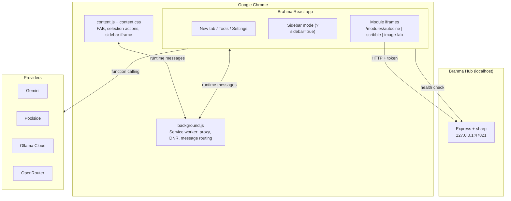

<div align="center">

# Brahma - Modular Chrome OS

### The modular AI browser workspace and Chrome extension

[](LICENSE)
[](manifest.json)
[](https://react.dev/)
[](https://www.typescriptlang.org/)
[](https://vitejs.dev/)
[](https://tailwindcss.com/)

<br />

> Brahma turns Chrome into a modular workspace: a mode-driven new tab, an in-page agent sidebar, browser tools for any website, and vendored creative apps. Heavy native work runs through a localhost Hub.

</div>

<br />

## Features

### Tri-mode workspace
- Study, Gaming, and Developer modes change themes, shortcuts, suggestions, and focus rules.
- Local shortcuts, notes, chat history, and preferences survive reloads.

### Brahma agent
- Gemini function calling plus OpenAI-compatible tool calling for Poolside, Ollama Cloud, and OpenRouter, with automatic model and provider fallback.
- If a provider rejects native tools, the agent retries without `tools` and parses the model's XML `<tool_call>` fallback format.
- Agent tools: every browser tool and Brahma module, including page text/selection, image scanning/download, YouTube transcripts, chat and NotebookLM export, screen OCR, extension control, module launching, and live module context.
- The agent targets the current tab automatically, works from either the new tab or the in-page sidebar, and returns tool results in chat without opening the Tools page.
- Chat attachments, voice input/output, sequential task mode, and a persistent Neural Archive of sources.

### Modular apps
- **AutoCine** - photo-to-video editor with beat-synced timelines and browser export.
- **Scribble Studio** - script-to-whiteboard-story studio with browser export.
- **Image Lab** - batch image scan, compress, convert, and download. Requires the local Hub.
- Modules run in isolated iframes. Each module can save a snapshot to Neural Archive or ask Brahma to review it.

### Browser tools on any site
- OCR with drag-crop, English and Hindi data bundled locally (no CDN).
- Readable page text and selected text capture.
- YouTube transcript extraction with timestamps.
- ChatGPT, Claude, and Gemini conversation export to Markdown/TXT.
- NotebookLM source export.
- Page image collection and download.
- Extension manager with enable/disable.
- Entry points: Tools page, top bar, rail, floating FAB menu, and the in-page sidebar **Site tools** toolbar.

### Local Brahma Hub
- Loopback-only companion service on `127.0.0.1:47821`.
- Token-protected, extension-origin CORS, no cloud dependency.
- Powers Image Lab and is reported by a top-bar Hub health chip.

### In-page copilot and HUD
- Floating FAB and side drawer on every page, with context hints for YouTube, GitHub, Wikipedia, and more.
- Analog clock, battery/memory telemetry, weather, and a distraction shield driven by Chrome proxy/DNR permissions.

## Architecture



Modules are built into `dist/modules/<id>/index.html` and loaded as extension iframes. This keeps each app's Tailwind/global CSS isolated from the Brahma shell.

## Repository Structure

```text
Brahma-AI---Modular-Chrome-OS/
  background.js             MV3 service worker
  manifest.json             Permissions, CSP, content scripts, WAR
  index.html                Brahma app root
  public/
    content.js              In-page FAB, selection actions, sidebar
    content.css
    page-tools.js           On-demand DOM extraction and overlays
    ocr/                    Tesseract worker, WASM, eng + hin data
  src/
    App.tsx                 Shell, modes, agent, settings, Tools wiring
    components/ToolsPage.tsx
    lib/browserTools.ts     Tabs, page tools, transcript, downloads
    lib/ocr.ts              Bundled Tesseract recognition
    lib/hub.ts              Hub URL/token/health helpers
    lib/ai/                 Provider catalog and fallback router
    modules/                Registry, host, dock
  modules/
    autocine/               Vendored photo-to-video editor
    scribble/               Vendored whiteboard story studio
    image-lab/              Vendored image optimizer + Hub server
  hub/
    server.ts               Local companion service
    start-brahma-hub.bat
    README.md
  scripts/copy-ocr-assets.mjs
  dist/                     Build output (load this unpacked)
```

## Getting Started

### Prerequisites
- Node.js 18+ and npm 9+
- Google Chrome or another Chromium browser
- Optional: an API key for at least one provider (Gemini recommended)

### Install and build

```powershell
npm install
npm run modules:install
npm run build
```

`npm run build` builds the React app, all three modules, copies the service worker/manifest/icons into `dist`, and includes the bundled OCR assets. OCR assets can be refreshed with `npm run ocr:assets`.

### Load the extension
1. Open `chrome://extensions`.
2. Enable **Developer mode**.
3. Click **Load unpacked** and select the `dist/` folder.
4. Open a new tab to launch Brahma.

### Add an AI key
Open Brahma Settings (or onboarding) and paste a key for your active provider. Gemini, Poolside, Ollama Cloud, and OpenRouter can all run browser tools. Keys are stored in `localStorage` on your machine.

### Start the Hub (Image Lab)
```powershell
.\hub\start-brahma-hub.bat
```

On first start the Hub creates a token in `hub/data/hub-token.txt` and prints it. Paste the token into **Brahma Settings > Brahma Hub**, click **Test Hub**, or use the top-bar Hub chip. Keep the terminal open while using Image Lab.

## Browser Tools

Open tools from the top bar/rail, the FAB menu, or the sidebar **Site tools** row. Sidebar buttons pin the exact source tab, so transcript/image actions do not depend on which tab is focused later.

| Tool | What it does |
| --- | --- |
| OCR & Text Grab | Capture the target tab, crop a region, recognize English or Hindi text |
| Page Text | Read readable text or the current selection |
| YouTube Transcript | Fetch caption tracks through YouTube's iOS player response (avoids the empty WEB `timedtext` gate), with player-response and transcript-panel fallbacks |
| Chat Export | Export the current ChatGPT, Claude, or Gemini conversation |
| NotebookLM | Export notebook sources to Markdown |
| Image Collector | Scan page images, select, and download them |
| Extensions | List installed extensions and toggle them |

## Desktop Screen OCR

`screen-ocr/` is a standalone Electron app that reuses the exact Brahma extension OCR logic and bundled Tesseract assets. Press **Ctrl + Shift + O**, drag over text in any desktop app outside Chrome, and the text is recognized locally. No Python, external OCR tool, or cloud OCR is used.

Run `run-screen-ocr.bat` from the repository root, or `cd screen-ocr && npm install && npm start`. For a single-file Windows build, run `cd screen-ocr && npm run dist`; the portable app is written to `screen-ocr\release\Brahma-Screen-OCR-1.0.0-portable.exe`. See `screen-ocr/README.md` for details.

## Agent Tools

Agent calls can use:
- Modules: `openModule`, `getModuleContext`
- Page content: `grabPageText`, `grabPageSelection`, `scanPageImages`, `downloadPageImages`, `readScreenText`
- Site exports: `getYouTubeTranscript`, `exportCurrentChat`, `exportNotebookSources`
- Extensions: `listExtensions`, `setExtensionEnabled`
- Workspace: `switchMode`, `openShortcut`, `searchWeb`, `openNewTab`, `navigateTo`, `goBack`, `goForward`, `closeCurrentTab`, `summarizePage`, `getWeather`

Browser tools run silently and return results directly in chat. Source content is also saved to Neural Archive. The agent resolves "this page" from the sidebar's host tab or the active web tab in the new-tab workspace. Multi-step requests joined with "then" are executed by the agent one step at a time. `getModuleContext` reads the open module, including modules opened in a full tab, via a shared snapshot.

Direct commands such as "extract the full transcript of this YouTube video", "extract OCR of this page", or "open AutoCine" take a deterministic fast path, so they work even when the selected model is weak at tool calling. If Chrome cannot screenshot a tab (for example, video-overlay pages), screen OCR falls back to extracting the tab's page text and says so in the reply.

## Permissions

| Permission | Purpose |
| --- | --- |
| `activeTab`, `tabs`, `scripting` | Target the right tab, inject `page-tools.js`, capture screenshots |
| `<all_urls>` | Work on any site the user opens a Brahma tool on |
| `downloads` | Save images and exports |
| `management` | Extension manager |
| `proxy`, `declarativeNetRequest*` | Distraction shield |
| `storage` | Local extension state |

## Scripts

```powershell
npm run dev             # Vite dev server on port 3000
npm run build           # Production build into dist/
npm run build:modules   # Rebuild only the three modules
npm run verify          # Lint + build + verify dist integrity
npm run verify:dist     # Verify manifest, assets, modules, OCR, and HTML references
npm run lint            # TypeScript check
npm run ocr:assets      # Copy Tesseract assets into public/ocr
npm run clean           # Remove dist
```

## Security and Privacy
- No telemetry server. Notes, settings, chats, and keys stay in local browser storage.
- AI requests go directly from the browser to the selected provider.
- The Hub binds to loopback only and requires a local token.
- OCR is fully local; worker, WASM, and language data ship with the extension.

## License

MIT. See [LICENSE](LICENSE).

```text
Copyright (c) 2025-2026 Suryaansh Tiwari
```
